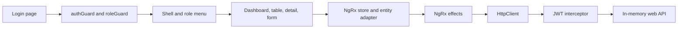

# Harborline

Harborline is an Angular admin portal for a fictional logistics company. Dispatchers and admins review shipments, open a status timeline, and book a new movement. Viewers can read the same records. The UI is in English and Spanish, and every visible label comes from a message catalog.

Authentication is a route guard plus an HTTP interceptor. The token is an unsigned demo JWT. Shipments live in an NgRx store (entity adapter, effects, and a feature state) and are loaded with server-style paging, sorting, and filtering. A lazy route owns that store. The backend is `angular-in-memory-web-api`, seeded with 18 fictional shipments. There is no real API, database, or credential store.

## Architecture



The mock API accepts:

- `POST api/auth/login`
- `GET api/shipments` with `page`, `pageSize`, `sort`, `order`, `search`, and `status`
- `GET api/shipments/:id`
- `POST api/shipments`
- `POST api/shipments/:id/events`
- `GET api/shipments?view=summary`

## Run

```bash
npm install
npm start
```

Open http://localhost:4317

Demo accounts, also listed on the sign-in page:

| Role | Email | Password |
| --- | --- | --- |
| Admin | admin@harborline.example | admin123 |
| Dispatcher | dispatch@harborline.example | dispatch123 |
| Viewer | viewer@harborline.example | viewer123 |

The viewer menu does not include **New shipment**. Opening that URL directly returns the viewer to the shipment list.

## Test

```bash
npm test
npm run lint
npm run build
```

`npm test` runs Jest unit tests for the login, shipment table, detail, and form components, the route guards, the JWT interceptor, the shipment query used by the mock API, and the NgRx reducer and effects. There are no browser or end-to-end tests.

GitHub Actions (`.github/workflows/ci.yml`) runs lint, unit tests, and the production build on push and pull request. This copy currently lives in Cursor Origin, which does not run that workflow.

## Portfolio note

This is a portfolio demo for Arpan Bom's CV. It is not a production system. The token is not signed, the passwords are fake sample data, and the shipment records are fictional. The on-time performance panel is an explicit placeholder: this demo does not invent an on-time rate or any other operating metric.
